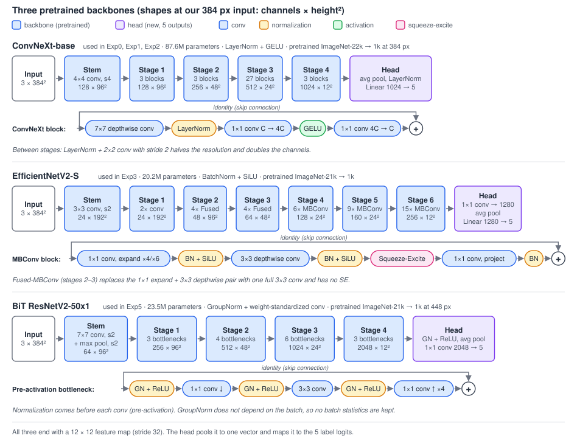
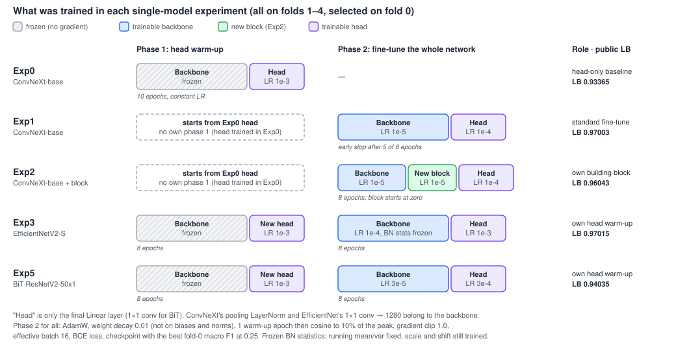
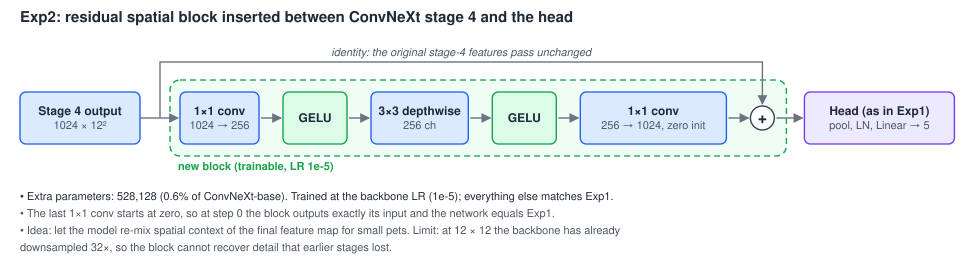
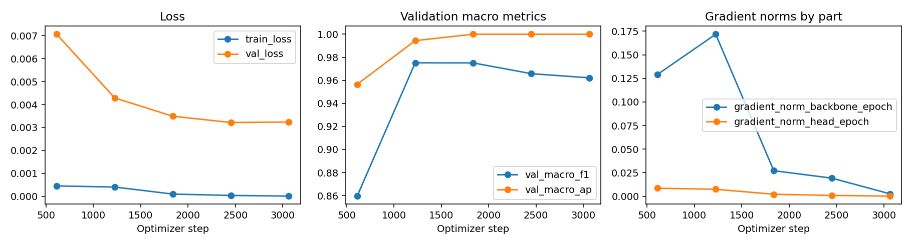
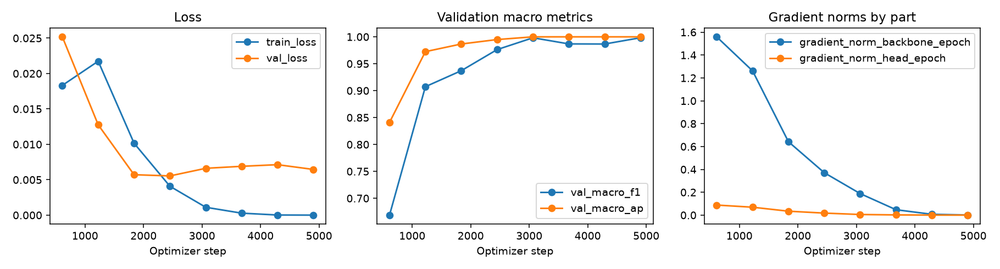
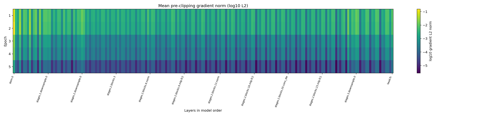
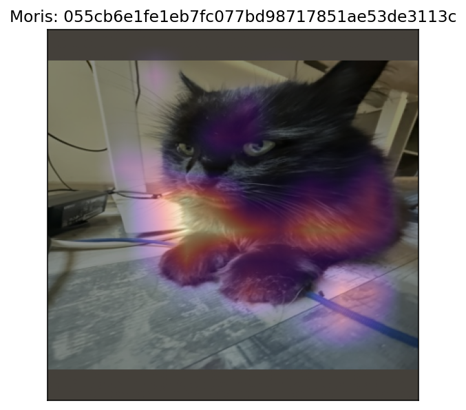
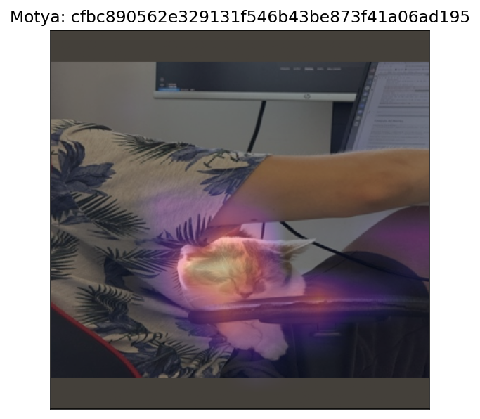
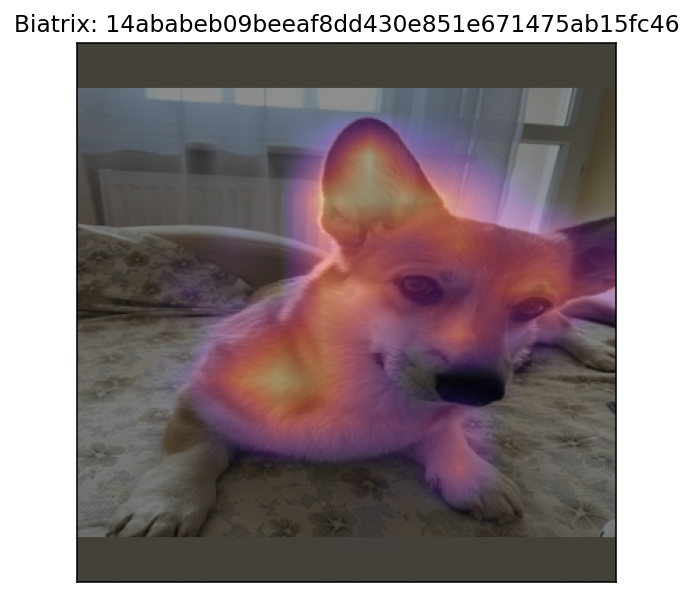
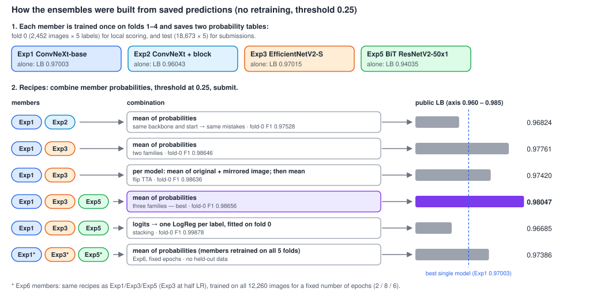

# AI301 Assignment 2: Cats and Dogs++

Multi-label image classification (Kaggle In-Class competition "Cats and Dogs++").
Each photo gets five 0/1 labels: `Cat`, `Dog` and three named pets, `Moris`, `Motya`, `Biatrix`. The target metric is **macro F1**.

| Notebook | Content |
|---|---|
| [01_eda.ipynb](notebooks/01_eda.ipynb) | Data checks, label combinations, image sizes |
| [02_metric.ipynb](notebooks/02_metric.ipynb) | Macro F1 analysis, thresholds, PR AUC |
| [03_validation.ipynb](notebooks/03_validation.ipynb) | Near copies, adversarial validation, folds, first submissions |
| [04](notebooks/04_convnext_profile.ipynb)–[07](notebooks/07_convnext_custom.ipynb), [09](notebooks/09_efficientnet.ipynb), [12](notebooks/12_bit_resnetv2.ipynb) | Single CNNs (Exp0–3, Exp5) |
| [08](notebooks/08_ensemble.ipynb), [10](notebooks/10_ensemble_exp1_exp3.ipynb), [11](notebooks/11_tta_ensemble.ipynb), [13](notebooks/13_ensemble_exp1_exp3_exp5.ipynb), [15](notebooks/15_stacking_logreg.ipynb) | Ensembles, TTA, stacking (Exp4) |
| [14_full_data_final.ipynb](notebooks/14_full_data_final.ipynb) | Retraining on all labelled data (Exp6) |

The fold assignment is saved in [folds.csv](folds.csv), so every model uses the same splits.

---

## 1. EDA

**Data quality.** Train has 12,260 images and test has 18,673. The CSV files and image folders match exactly: no missing files, no extra files, no duplicate IDs. Labels are only 0 and 1, with no NaN.

**Labels.** Moris and Motya are always cats, and Biatrix is always a dog. That leaves only 8 label combinations in train:

| Combination | Photos |
|---|---|
| Cat | 4989 |
| Dog | 4984 |
| No labels | 2162 |
| Cat + Moris | 42 |
| Dog + Biatrix | 37 |
| Cat + Motya | 32 |
| Cat + Moris + Motya | 10 |
| Cat + Dog + Moris + Biatrix | 4 |

**Class imbalance.** Cat is 41.4% of train, Dog is 41.0%, and 17.6% of the photos have no label. The named pets are very rare: Moris 56 photos (0.46%), Motya 42 (0.34%), Biatrix 41 (0.33%). Since the metric is macro F1, these three rare labels make up 60% of the score, so the imbalance is the main difficulty of the task.

**Image size.** Every image in train and test is 450x375, and the size does not depend on the label. So the model cannot use size as a shortcut, and we don't need to resize anything to make the sizes equal.

**Look at the photos.** The photos with no label contain easy negatives (lobster, turkey, horses) and hard ones (wombat and other furry animals), which can trigger false Cat or Dog predictions. Generic cats and dogs look like web photos: many breeds, a large animal in the center. Moris, Motya and Biatrix look like phone photos from one home and from walks, and the pet is often small in the frame. Two risks follow from this:
- the model may learn the background (home, street) instead of the pet;
- strong cropping can cut the small pet out of the image, so augmentation should be gentle.

---

## 2. Metric analysis

### Why macro F1 fits this task
Accuracy or micro-averaged F1 would be dominated by Cat and Dog. We checked this with trivial predictions on train:

| Prediction | Cat | Dog | Moris | Motya | Biatrix | Macro F1 |
|---|---|---|---|---|---|---|
| all ones | 0.586 | 0.581 | 0.009 | 0.007 | 0.007 | 0.238 |
| perfect | 1 | 1 | 1 | 1 | 1 | 1.0 |
| perfect Cat/Dog, zeros for named pets | 1 | 1 | 0 | 0 | 0 | 0.4 |

Both perfect cases match a hand calculation, so our implementation is correct. The last row reveals the key point: a model that is perfect on Cat and Dog but ignores the named pets gets only 0.4. So we need to pay a lot of attention to minor classes.

### Weaknesses and edge cases
- **Very noisy for rare labels.** With about 40-60 photos per named pet, one more missed photo lowers the macro F1 by about 0.002-0.003 (a miss in Cat or Dog costs only 0.00002). We call two macro F1 scores *similar* if they differ by less than **0.005**, which is about 2 photos of a named pet. A smaller gain is not a real gain.
- **Depends on the threshold.** With the same model, moving the threshold changed macro F1 by 0.014 (see below). Without a fixed threshold, a better threshold can look like a better model.
- **Undefined F1.** If a label has no true and no predicted photos, F1 is 0/0 and sklearn returns 0, so even a perfect answer loses 0.2. It cannot happen in our folds (8-12 photos of each named pet per fold), but it happens in small batches. So we compute F1 only on the full validation set, never per batch.
- **Labels are scored separately.** Macro F1 does not see the rows, so impossible combinations (e.g. Biatrix = 1 but Dog = 0) are not punished. We tried the rule "a predicted named pet sets Cat/Dog to 1". It changed 3 photos of 12,260, gave +0.00002 macro F1 (far below 0.005), so we do not use it.

### Baseline used for the analysis
To study the metric we need some predictions, so we took a pretrained `convnext_base.fb_in22k_ft_in1k_384` (ImageNet only) as a frozen feature extractor (1024 numbers per image), and trained one logistic regression per label. All scores below are out-of-fold, using the folds from section 3.

| Threshold | Cat | Dog | Moris | Motya | Biatrix | Macro F1 |
|---|---|---|---|---|---|---|
| 0.5 | 0.997 | 0.997 | 0.869 | 0.853 | 1.000 | 0.943 |
| 0.25 | 0.997 | 0.996 | 0.917 | 0.914 | 0.976 | 0.960 |

Almost all of the loss comes from Moris and Motya (at 0.5 they miss 13 of 56 and 10 of 42 photos). The lower threshold helps because the named pets are rare and the model is shy to predict them.

Picking 0.25 on the same data we score is optimistic, so we also did a fair check: for each fold, take the best threshold from the other 4 folds and apply it only to the held-out fold. Macro F1 is then **0.957** (the thresholds chosen were 0.25 in four folds and 0.30 in one, so 0.25 is stable). We use **0.25**.

### Complementary metrics
- **PR AUC (per label, macro mean)**: no threshold, and it ignores the huge number of easy negatives.
- **Per-label F1**: shows *which* label is failing, since macro F1 hides it.
- **ROC AUC**: we checked it and do not use it. It is ≥ 0.999 for every label (even Moris beats Dog), because the false positive rate divides by about 12,000 negatives, so a few false alarms cost almost nothing.

| Metric | Cat | Dog | Moris | Motya | Biatrix | Macro |
|---|---|---|---|---|---|---|
| F1 at 0.25 | 0.997 | 0.996 | 0.917 | 0.914 | 0.976 | 0.960 |
| PR AUC | 1.000 | 1.000 | 0.981 | 0.977 | 1.000 | 0.991 |
| ROC AUC | 1.000 | 1.000 | 1.000 | 1.000 | 1.000 | 1.000 |

PR AUC also tells us *why* we lose points. Biatrix has PR AUC 1.0 but F1 0.976: the ranking is perfect, so only the threshold is to blame. Moris has PR AUC 0.981: some wrong photos rank above real Moris photos, so only a better model can help.

### Proposed alternative target metric
**Macro PR AUC.** It keeps the 20% weight for each label (so the rare pets count), needs no threshold, and is not inflated by easy negatives. It lets us compare models without mixing in threshold tuning. We keep macro F1 as the official metric and report macro PR AUC next to it.

---

## 3. Validation

### Strategy
**Stratified 5-fold split** over the 8 label combinations (`StratifiedKFold`, `shuffle=True`, `random_state=42`), saved in `folds.csv`. Stratifying by the *combination* (not by each label) puts the rare pets evenly into every fold:

| Combination | f0 | f1 | f2 | f3 | f4 |
|---|---|---|---|---|---|
| Cat / Dog | ~998 | ~997 | ~998 | ~998 | ~998 |
| Cat + Moris | 8 | 8 | 9 | 9 | 8 |
| Cat + Motya | 7 | 6 | 6 | 6 | 7 |
| Dog + Biatrix | 8 | 8 | 7 | 7 | 7 |

Why this choice: images have no time or group information. EXIF is stripped in all 30,933 photos (no capture time), and there is no owner or series ID. So there is nothing to split by, and a stratified split is the natural option. The test set is a random-looking sample of the same data (see below), so this should correlate well with the leaderboard.

### Near-duplicates
Photos of the named pets may come in series, which would cause leakage between folds. With no EXIF time, we looked for them using the cosine similarity of the ConvNeXt embeddings. By eye, pairs of named-pet photos at cosine ≥ 0.95 show the same scene (this does not hold for all train photos, so we use it only for pets).

Only 22 of 125 named-pet photos have such a near copy, and 15 of them (68%) are in test, 7 (32%) in train. Test is 60% of all photos, so near copies are spread about as expected by chance. A validation fold with near copies in train therefore looks like test, so we **do not group near copies** into one fold. This is not proven; with 22 photos, one photo moves the percentage by about 5 points.

### Adversarial validation
We trained a logistic regression (same model type as the main baseline) on the embeddings to tell train (0) from test (1), with 5 stratified folds. The ROC AUC is **0.501** (folds between 0.494 and 0.509), so the model cannot separate train from test. No distribution shift is visible, and we keep the same split with no extra action.

### CV vs leaderboard

| Model | Threshold | CV macro F1 | Public LB |
|---|---|---|---|
| ConvNeXt-base embeddings + LogReg | 0.25 | 0.957 (fair check; 0.960 optimistic) | 0.92922 |
| ConvNeXt-base embeddings + LogReg | 0.5 | 0.943 | 0.92186 |

The leaderboard is lower than CV by about 0.03 (at 0.25) and 0.02 (at 0.5). The good news: the order of the two thresholds is the same on CV and LB, so the CV choice holds on unseen data.

**Why the gap?** One explanation (not confirmed) is that test has more named-pet photos than train. The model predicts about 2-3 times more named pets in test than the train share suggests:

| Label | Expected from train share | Predicted at 0.25 |
|---|---|---|
| Cat | 7733 | 7771 |
| Dog | 7653 | 7681 |
| Moris | 85 | 169 |
| Motya | 64 | 115 |
| Biatrix | 62 | 184 |

If most of these were false alarms, the LB score would be much lower than 0.92, so many of them are probably real pets. Since the model learned that these pets are very rare, it may miss some of them. With so few photos per pet, a gap of 0.02-0.03 is also not far from the noise level of the metric (1 photo ≈ 0.0025).

**Decision.** Compare models by CV macro F1 (and macro PR AUC), treat differences below 0.005 as noise, and expect the LB to be about 0.02-0.03 lower than CV. Use threshold 0.25 for now.

---

## 4. Single CNN models

### Setup
- **Infrastructure:** PyTorch Lightning for training, W&B and CSV logs, and a JSON run record for every run (config, code hashes, metrics, checkpoint hash). Shared code is in [stage2/](stage2/), and per-experiment notes are in [experiments/](experiments/).
- **Common protocol:** train on folds 1–4 and validate on fold 0 (2,452 images, 8–10 photos per named pet). Input is a 384-pixel letterbox, the only augmentation is a horizontal flip, the loss is BCEWithLogitsLoss, and the optimizer is AdamW (weight decay 0.01) with effective batch 16. The schedule is one warm-up epoch, then cosine decay. The checkpoint with the best fold-0 macro F1 is kept, and every submission uses threshold 0.25.
- **Pretrained weights:** timm, ImageNet only.
- **"CV" in this section is a single fold (fold 0), not 5-fold CV.** We had no time budget for 5 folds: one fine-tuning run took 2–6 hours on a Mac GPU. On fold 0, one named-pet photo moves macro F1 by about 0.012.

### Architectures

- **ConvNeXt-base** (Exp0–2) is a classic CNN redesigned with ideas from Vision Transformers:
  - a "patchify" stem (4×4 conv, stride 4);
  - large 7×7 depthwise kernels;
  - LayerNorm and GELU;
  - an inverted bottleneck (C → 4C → C).

  Most of its depth is in stage 3 (27 blocks). It is our largest model (87.6M parameters), and its pretrained weights were fine-tuned at 384 px, our input size.
- **EfficientNetV2-S** (Exp3) was found by architecture search and scaled jointly in depth, width and resolution.
  - The early stages use Fused-MBConv (one full 3×3 conv), which is faster on large feature maps.
  - The later stages use MBConv: a 3×3 depthwise conv inside an expanded 1×1 bottleneck, plus squeeze-and-excitation, which reweights channels using global image context.
  - It uses BatchNorm. Our physical batch was only 8, so we froze BatchNorm's running mean and variance (the pretrained values) and trained only its scale and shift.
- **BiT ResNetV2-50x1** (Exp5) is a ResNet-50 built for transfer learning.
  - Its bottlenecks are pre-activation: normalization and ReLU come before each conv, so the skip path is a clean identity.
  - It uses GroupNorm and weight-standardized convolutions, neither of which depends on the batch, so it needs no special BatchNorm handling.
  - Its native resolution is 448 px. We used 384 px.

**Why these three:** they differ in block design and in normalization (LayerNorm, BatchNorm, GroupNorm), so we expected them to make different mistakes. This is what the ensembles in section 5 rely on. All three end in a 12 × 12 feature map. The only new layer is the 5-output classifier.

### What was trained

- **ConvNeXt:**
  - Exp0 trains only the final Linear layer on frozen features.
  - Exp1 and Exp2 start from that layer and unfreeze the whole network. The head gets 10× the backbone learning rate, so the pretrained features change only slightly while the head keeps adapting.
- **EfficientNet and BiT:** Exp0's head fits ConvNeXt's 1024 features, not theirs, so each model first trains its own head on a frozen backbone (phase 1, 8 epochs), then fine-tunes everything (phase 2). Without phase 1, the gradients of a random head would hit the pretrained backbone in the first steps.
- **Learning rates** are untuned starting guesses for each family. Exp3's 1e-4 / 1e-3 later looked too high (see the notes below).

### Results

| Exp | Model | Training | Fold-0 F1 | Public LB |
|---|---|---|---:|---:|
| — | LogReg on frozen ConvNeXt embeddings (section 3) | — | 0.957 (5-fold) | 0.92922 |
| [Exp0](experiments/exp0/) | ConvNeXt-base, frozen backbone + linear head | 10 epochs, LR 1e-3 | 0.93577 | 0.93365 |
| [Exp1](experiments/exp1/) | ConvNeXt-base, full fine-tune (88M) | LR 1e-5 / 1e-4 (backbone / head), early stop at epoch 5 | 0.97518 | 0.97003 |
| [Exp2](experiments/exp2/) | ConvNeXt-base + our residual spatial block | Same as Exp1, 8 epochs | 0.97401 | 0.96043 |
| [Exp3](experiments/exp3/) | EfficientNetV2-S (20M) | Own head warm-up, LR 1e-4 / 1e-3, frozen BN statistics | 0.99831 | 0.97015 |
| [Exp5](experiments/exp5/) | BiT ResNetV2-50x1 (23.5M) | Own head warm-up, LR 3e-5 / 3e-4 | 0.99851 | 0.94035 |

Solid baseline: 0.90624. Every model beats it.

### Notes per experiment
- **Exp0.** A frozen backbone with a trained head is barely better than the LogReg baseline. Its main purpose was to provide a starting head for Exp1 and Exp2.
- **Exp1.** Fine-tuning the whole network gave +0.036 on the leaderboard over Exp0. It is our best single model, and the CV–LB gap is small (0.005).
- **Exp2 (own building block).** A 1×1 reduce → 3×3 depthwise → 1×1 restore block with a residual connection is inserted before pooling. The last projection is initialized to zero, so the network starts identical to Exp1. It adds 0.53M parameters. Fold 0 is equal to Exp1 (−0.001, about 0.1 photo), but the leaderboard is 0.0096 lower. **The block did not help.** It came after the backbone has already downsampled the image, so it cannot recover detail of small pets.

  
- **Exp3.** A different family, chosen for the ensemble. The leaderboard ties Exp1 (+0.0001). The fold-0 gain (+0.023) is exactly two named-pet photos and did not transfer. Validation loss rose after epoch 4 while training loss went to about 0, so the model overfit and became over-confident. The likely cause is a learning rate 10× higher than for ConvNeXt.
- **Exp5.** Best on fold 0 (perfect on all three pets), but the weakest on the leaderboard (0.94035, a gap of 0.058). **Fold 0 is too small to rank models.** Possible causes (not tested): 384 px instead of the native 448 px for a model that sees small pets, and lucky checkpoint selection on fold 0.

### Failed runs
- The first EfficientNet head warm-up (3 epochs) stopped at macro F1 0.774 while the rare labels were still improving. We raised it to 8 epochs (0.910).
- Exp2 smoke run: device mismatch, with CPU weights and an MPS input ("Input type (MPSFloatType) and weight type (torch.FloatTensor) should be the same"). We fixed this and reran.
- Exp2 full run `mps_full1` was interrupted during training. A later run stopped at our timing gate because the first epoch took 42 minutes.

### Diagnostics
We show the full diagnostics for **Exp1** (our best single ConvNeXt) and **Exp3** (the model that overfit most). The same files exist for every run under `experiments/exp*/results/<run>/`.

**Loss and metric curves.**

Exp1 (ConvNeXt, LR 1e-5 / 1e-4):

Exp3 (EfficientNetV2-S, LR 1e-4 / 1e-3):

- Training loss goes to about 0 in both runs, so both models memorise the training folds. Validation loss stops improving after epoch 3-4 in Exp1 (flat at about 0.003). In Exp3 it rises again after epoch 4 (0.0055 → 0.0071), which is overfitting.
- In Exp1 fold-0 macro F1 peaks at epochs 2-3 (0.975) and then falls to 0.962, while macro AP stays at 1.0 from epoch 3. The ranking of the images is perfect, but the fixed threshold 0.25 no longer fits: the model has become over-confident, so a few probabilities are pushed to the wrong side. This is the same message as in section 2 (a threshold effect, not a ranking error), and the reason we select the checkpoint by F1 and stop early.
- The F1 curve is a staircase of a few photos: one named-pet photo on fold 0 is about 0.012, so differences of 0.01 between epochs are noise-level.

**Gradient flow** (mean gradient norm per layer, before clipping, log scale; x axis is the layer order from the stem to the head, y axis is the epoch):

- No vanishing or exploding gradients. The earliest layers (stem, stage 1) get gradients as large as the layers near the head, so the signal reaches the whole depth of the 88M-parameter network. We think the reasons are the residual connections and LayerNorm, but we did not ablate them.
- Gradients drop by about 2-3 orders of magnitude from epoch 1 to epoch 5 as the training loss goes to 0 and the cosine schedule lowers the learning rate. The gradient norm per part (right panel of the curves) agrees: the backbone is much larger than the head (the head has few parameters), and both die out together.
- Exp3 (EfficientNetV2-S) has about 10× larger gradients at the start (backbone norm 1.5 against 0.17), consistent with our note that its learning rate was too high. One column in the middle of its network (a late `blocks.4`/`blocks.5` layer) is dark in all epochs, meaning this layer gets almost no gradient. We did not investigate it.
- In Exp2 the gradient of our new block is the smallest of the three parts in every epoch (green line in `experiments/exp2/.../curves.png`). The block starts as an identity (zero-initialised last layer), and the network never needed it: this fits the result that it did not help.

**GradCAM** (Exp1, last ConvNeXt stage, 12×12 map upsampled to the 384 px input; for each label, the first positive fold-0 photo, chosen before looking at predictions):

| Moris | Motya | Biatrix |
|---|---|---|
|  |  |  |

- **Biatrix and Moris:** the attention is on the animal (ears, body, chest and paws), not on the room. This is the good sign we looked for in section 1, where we worried the model might learn the home background.
- **Motya:** the cat is small and half hidden on a person's lap, and the model still looks mostly at the cat's face. Part of the heat also falls on the dark chair region next to it, so it is not a clean "only the pet" explanation.
- Three photos are only illustrations, not proof. The map is coarse (12×12), and we did not run the check where the pet is masked out and the prediction is re-scored. Cat and Dog maps for the same run are in the `gradcam/` folder.

### Is the model adequate?
**In short, yes**

- **It beats the baseline by a large margin.** Every single model scores above it (0.934-0.970; the fine-tuned ConvNeXt and EfficientNet reach 0.970) against the solid baseline 0.90624; the best ensemble scores 0.98047.
- **Local validation and the leaderboard agree for the main model.** Exp1: fold 0 0.975 against LB 0.970 (gap 0.005, within the noise of about 2 named-pet photos). The frozen-feature models behave the same way (Exp0 0.936 → 0.934). The CV gap of 0.02-0.03 seen for the LogReg baseline in section 3 disappeared once the model was fine-tuned, which supports our explanation there that the baseline was too weak on rare pets.
- **Local validation is not reliable for ranking close models.** Exp3 (+0.023 on fold 0) and Exp5 (+0.023, perfect on all pets) beat Exp1 on fold 0 but tie it (Exp3) or lose by 0.03 (Exp5) on the leaderboard. Fold 0 has 8-10 photos per pet, and checkpoints were selected on it, so it is optimistic. We therefore trust the leaderboard order for these comparisons only roughly: it is the public part of the test set, and ties within 0.005 are noise.
- **What the model gets right, and what it does not.** Cat and Dog F1 are about 0.997 for every model. All remaining loss comes from the three rare pets (Motya and Biatrix F1 0.94 in Exp1, one photo wrong each). The diagnostics show no optimisation problem (healthy gradients, no divergence); the models overfit the training folds, but early stopping and checkpoint selection handled it.
- **Where we would not trust it.** (1) Everything rests on one fold and one seed; we have no confidence intervals. (2) Our decisions on threshold (0.25) and equal ensemble weights were made without enough rare-pet data to tune them. (3) The public leaderboard is a part of test, and the private score may differ. (4) The retraining on all data (section 6) lowered the score, which shows that our results are sensitive to small changes and not fully reproducible by simply adding data.

---

## 5. Ensembling

All ensembles reuse saved fold-0 and test probabilities. Nothing is retrained. Weights are equal and the threshold is 0.25, because fold 0 has too few pets to tune them.

**How each ensemble was built:**
1. Every member was trained once (section 4) and saved its probabilities for the 2,452 fold-0 images and the 18,673 test images.
2. An ensemble reads those files and combines them per image and label. For each recipe, the same combination is applied to fold 0 (local score) and to test (submission).
   - **Mean:** average the members' probabilities.
   - **Flip TTA:** each model also predicts the mirrored image, its two probabilities are averaged, and then the models are averaged.
   - **Stacking:** probabilities are turned into logits, and one logistic regression per label is fitted on the fold-0 logits of the three members.
3. Apply threshold 0.25 and write the CSV.

| Ensemble | Fold-0 F1 | Public LB |
|---|---:|---:|
| Mean Exp1 + Exp2 | 0.97528 | 0.96824 |
| Mean Exp1 + Exp3 | 0.98646 | 0.97761 |
| Mean Exp1 + Exp3, flip TTA | 0.98636 | 0.97420 |
| **Mean Exp1 + Exp3 + Exp5** | 0.98656 | **0.98047** |
| LogReg stacking of Exp1 + Exp3 + Exp5 | 0.99878 (out-of-fold within fold 0) | 0.96685 |

- **Exp1 + Exp2 did not help** (below Exp1 alone). Both models start from the same backbone and head, so they make the same mistakes: they disagree in only 66 test cells.
- **Exp1 + Exp3 helped (+0.0075).** The two models come from different families and disagree in 219 test cells.
- **Flip TTA hurt (−0.0034).** It changed only 32 test cells, 5 of them named-pet cells. On test, one named-pet cell is worth about 0.0007, so five wrong ones explain the drop. Fold 0 showed no effect at all.
- **Adding Exp5 gave our best score (0.98047),** even though Exp5 alone is weak. It acts as a tie-breaker. Every named-pet decision it added was flagged by BiT, and every one it removed was supported by Exp1 or Exp3 but not by BiT.
- **Stacking hurt (−0.0136)** ([notebook 15](notebooks/15_stacking_logreg.ipynb)). One logistic regression per label is fitted on the members' fold-0 logits and validated by repeated 5-fold CV inside fold 0. The learned weights are almost equal, so the model behaves like a mean of logits. Locally it beat the probability mean, but the whole gain is one Biatrix photo. On test it removed 26 named-pet positives, the ones where only one member was confident. The drop fits about 22 of them being real pets. Fold 0 (27 pet photos) is too small to learn a combination rule.

---

## 6. Retraining on all data (failed)

We retrained the three members of the best ensemble on all 12,260 images ([notebook 14](notebooks/14_full_data_final.ipynb)). Each model trained for the fixed epoch count of its fold-0 best checkpoint, and Exp3's learning rate was halved.

| Submission | Public LB |
|---|---:|
| Fold-0 members (folds 1–4), threshold 0.25 | **0.98047** |
| Full-data members, threshold 0.25 | 0.97386 |
| Full-data members, tuned thresholds (Cat 0.45, Dog 0.5) | not submitted |

The score dropped by 0.0066, about 9–10 more wrong named-pet decisions. ConvNeXt added about 20 weak Moris positives (median probability 0.33). It stopped after 2 of 8 schedule epochs, near the peak learning rate. We changed several things at once (more data, no checkpoint selection, a different Exp3 LR), so the drop cannot be attributed to a single cause.

---

## 7. Final result and conclusions

### Summary of all experiments (fold-0 score and public LB)

All "CV" values are fold 0, not 5-fold CV (see section 4). Exp6 has no held-out data, so it has only an LB score.

| Experiment | Fold-0 macro F1 | Public LB |
|---|---:|---:|
| LogReg on frozen ConvNeXt embeddings (threshold 0.25) | 0.957 (5-fold) | 0.92922 |
| Exp0 ConvNeXt, frozen + linear head | 0.93577 | 0.93365 |
| Exp1 ConvNeXt, full fine-tune | 0.97518 | 0.97003 |
| Exp2 ConvNeXt + residual spatial block | 0.97401 | 0.96043 |
| Exp3 EfficientNetV2-S | 0.99831 | 0.97015 |
| Exp5 BiT ResNetV2-50x1 | 0.99851 | 0.94035 |
| Exp4 mean Exp1 + Exp2 | 0.97528 | 0.96824 |
| Exp4 mean Exp1 + Exp3 | 0.98646 | 0.97761 |
| Exp4 mean Exp1 + Exp3, flip TTA | 0.98636 | 0.97420 |
| **Exp4 mean Exp1 + Exp3 + Exp5** | 0.98656 | **0.98047** |
| Exp4 LogReg stacking Exp1 + Exp3 + Exp5 | 0.99878 (inner CV) | 0.96685 |
| Exp6 same three models, all data | n/a | 0.97386 |

- **Best submission:** mean of Exp1 + Exp3 + Exp5, public LB **0.98047** (solid baseline 0.90624).
- **What worked:** full fine-tuning (+0.036 over a frozen backbone), and averaging models from different families, even a weak one (Exp5).
- **What did not work:** our residual block (Exp2), flip TTA, logistic regression stacking, and retraining on all data. These failures are in the report on purpose: each one is explained by the very small number of rare-pet photos, where one photo changes the score by 0.001-0.012.
- **Fold 0 ranks models badly** (8-10 photos per pet, and checkpoints were also chosen on it). The leaderboard and fold 0 agree only for the models in which the difference is larger than the noise.

### Limitations and what we would do next
- Run all five folds with several seeds and report the mean and standard deviation. This is the main missing piece, and the reason for the weak fold-0/LB agreement.
- We tried one optimiser (AdamW) and one schedule (warm-up + cosine). Learning rates were starting guesses and were not tuned; Exp3's looked too high. A small sweep (LR, weight decay, a one-cycle or constant schedule, label smoothing or a class-weighted/focal loss for rare pets) was not done.
- Augmentation was only a horizontal flip, to avoid cropping out small pets. A mild-augmentation experiment (colour jitter, small scale/rotation) is untested.
- Use 448 px for BiT (native resolution), which could explain its weak LB score.
- Keep the Exp3 training epoch count for the full-data retraining and keep the same learning rates, so that only one factor (more data) changes.
- Choose thresholds per label from out-of-fold predictions of all five folds, where there are 40-56 pets per label instead of 8-10.

---

## AI tools

Claude Code was used to help with structuring and organizing the report. The conversation transcripts are in [transcripts/](transcripts/).

The diagrams in [docs/figures/](docs/figures/) and the architecture and training descriptions around them in sections 4 and 5 were generated with Claude Code using the **Claude Opus 5.5** model. The diagrams are drawn by [scripts/make_report_figures.py](scripts/make_report_figures.py). Layer shapes in them were checked against timm at 384 px, and the scores were checked against the run records.

**AI usage**: Claude Code/Codex was used to create some of the core functions in stage2 + to correctly set up notebooks and experiments.

**Example prompts:**
- "Please, help me set up this notebook to be executed locally on MAC/Colab"
- "Run a quick check for the notebook to be ready for overnight training"
- "Create a function read_probabilities() to process csv file with raw numbers to produce clean binary results for 5 output channels", etc.

